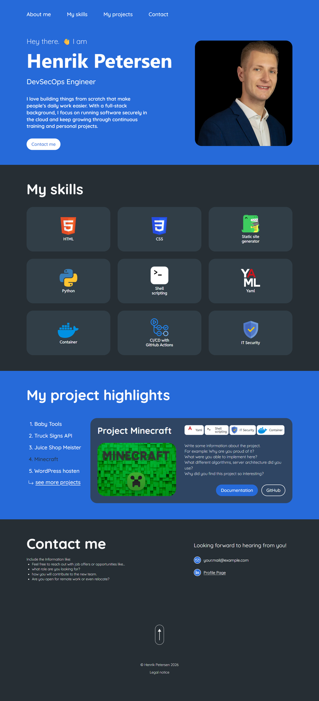
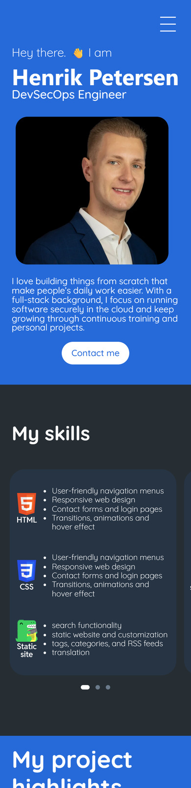

# My Developer Blog and Portfolio

A [Docusaurus](https://docusaurus.io/) site that combines a personal developer portfolio (start page, built with React and TypeScript) with project documentation. The portfolio presents skills, project highlights and contact details and links every project to its documentation in this site. It is deployed to GitHub Pages by a GitHub Actions pipeline.



## Table of Contents

- [Features](#features)
- [Quickstart](#quickstart)
  - [Prerequisites](#prerequisites)
  - [How to start](#how-to-start)
- [Usage](#usage)
  - [Available scripts](#available-scripts)
  - [Configuration](#configuration)
  - [Customizing the portfolio](#customizing-the-portfolio)
  - [Build](#build)
  - [Deployment](#deployment)
- [Repository Structure](#repository-structure)
  - [Portfolio components](#portfolio-components)
  - [All files in the repository](#all-files-in-the-repository)
- [Extras](#extras)
- [Contributing](#contributing)
- [License](#license)

## Features

- **Portfolio start page** (`src/pages/index.tsx`) with the sections Header, Hero, My skills, My project highlights, Contact and Footer, each implemented as its own React component.
- **Responsive design** for desktop and mobile, styled with CSS Modules.
- **Project documentation** in `docs/projects/`, linked from every project card of the portfolio.
- **Optional blog** (switched on with `BLOG_ENABLED=true`).
- **CI/CD pipeline** that type-checks, builds and deploys the site to GitHub Pages on every push to `main`.



## Quickstart

### Prerequisites

- [Node.js](https://nodejs.org/) 26 or later (the version defined in `package.json` under `engines`; Docusaurus itself needs at least 20)
- npm (comes with Node.js)
- Git
- [Docker](https://www.docker.com/products/docker-desktop), only if you deploy with NGINX

### How to start

1. Clone the repository and change into the folder:

   ```bash
   git clone https://github.com/hpetersen2/my-dso-blog.git
   cd my-dso-blog
   ```

2. Create your local configuration from the example file:

   ```bash
   cp example.env .env
   ```

   For local development set `BASE_URL=/` in `.env` (see [Configuration](#configuration)).

3. Install the dependencies:

   ```bash
   npm install
   ```

4. Start the development server:

   ```bash
   npm start
   ```

   The site opens at <http://localhost:3000/>. Changes are reflected live.

## Usage

### Available scripts

| Command             | Description                                                              |
| ------------------- | ------------------------------------------------------------------------ |
| `npm start`         | Starts the development server with hot reloading.                        |
| `npm run build`     | Creates the static site in the `build/` folder.                          |
| `npm run serve`     | Serves the content of `build/` locally to test a production build.       |
| `npm run typecheck` | Runs the TypeScript compiler without emitting files.                     |
| `npm run clear`     | Removes generated files and caches (`build/`, `.docusaurus/`).           |

### Configuration

The site is configured with environment variables. They are read from a `.env` file (local) or from `example.env` (CI pipeline, which copies it to `.env` before the build). Never commit real secrets: `.env` is listed in `.gitignore`, only `example.env` is versioned and must not contain secrets.

| Variable            | Description                                                         | Default in `example.env`        |
| ------------------- | ------------------------------------------------------------------- | ------------------------------- |
| `DEPLOYMENT_URL`    | Origin the site is served from.                                     | `https://hpetersen2.github.io`  |
| `BASE_URL`          | Path below the origin. `/<repository>/` on GitHub Pages, `/` locally or on a custom domain. | `/my-dso-blog/` |
| `GITHUB_ORG`        | GitHub user or organisation that owns the repository.               | `hpetersen2`                    |
| `GITHUB_PROJECT`    | Repository name.                                                    | `my-dso-blog`                   |
| `DEPLOYMENT_BRANCH` | Branch used by `docusaurus deploy`.                                 | `main`                          |
| `BLOG_ENABLED`      | `true` adds the blog and its navbar and footer links.               | not set (blog disabled)         |

> **Note:** With `BASE_URL=/my-dso-blog/` the local development server is available at <http://localhost:3000/my-dso-blog/>.

### Customizing the portfolio

All portfolio content lives in a few files:

| What you want to change                          | Where                                                                           |
| ------------------------------------------------ | ------------------------------------------------------------------------------- |
| Name, role and introduction text                 | `src/components/hero/index.tsx`                                                 |
| Photo                                            | Replace `static/img/portfolio/profile.webp` (keep the file name).               |
| Skills, their icons and the hover/carousel texts | `src/data/skills.ts` (icons in `static/img/portfolio/icons/`)                   |
| Projects, tags, screenshots and links            | `src/data/projects.ts` (screenshots in `static/img/portfolio/projects/`)        |
| Mail address and profile link                    | `src/components/contact/index.tsx`                                              |
| Name in the copyright line and legal notice link | `src/components/footer/index.tsx`                                               |
| Colors and fonts                                 | CSS variables in `src/pages/index.module.css` (class `.portfolio`)              |
| Order or number of sections                      | `src/pages/index.tsx`                                                           |

**Add a project:**

1. Put the screenshot into `static/img/portfolio/projects/`.
2. Add an entry to the `projects` array in `src/data/projects.ts`. The values in `tags` must match the `name` of a skill in `src/data/skills.ts`. `docsUrl` starts with `/docs/` for pages of this site, `githubUrl` with `https://`.
3. Run `npm run build`. Docusaurus fails the build if `docsUrl` points to a page that does not exist.

**Add a skill:** add an entry to the `skills` array in `src/data/skills.ts` and place the icon in `static/img/portfolio/icons/`. The mobile carousel shows three skills per page (`skillSlides`).

### Build

```bash
npm run build
```

The static files are written to `build/`. Use `npm run serve` to look at the result locally. Because broken internal links make the build fail (`onBrokenLinks: 'throw'`), a successful build also confirms that all documentation links of the portfolio are valid.

### Deployment

#### GitHub Pages (CI/CD)

The workflow `.github/workflows/main.yml` runs on every push and pull request to `main` and calls `.github/workflows/deploy.yaml`:

1. Install the dependencies (`npm ci`).
2. Type-check the project (`npm run typecheck`).
3. Copy `example.env` to `.env` and build the site (`npm run build`).
4. Upload the `build/` folder as Pages artifact.
5. Deploy the artifact to GitHub Pages (only on the default branch).

One-time setup in the GitHub repository:

1. Open **Settings → Pages**.
2. Select **GitHub Actions** as source.
3. Push to `main` (or run the workflow manually via **Actions → Deploy to GitHub Pages → Run workflow**).

The site is then available at <https://hpetersen2.github.io/my-dso-blog/>.

#### NGINX with Docker

The `Dockerfile` builds the site and serves it with NGINX.

## Repository Structure

### Portfolio components

Each component lives in its own kebab-case folder in `src/components/` with the component in `index.tsx` and its CSS Module named after the folder.

| Folder                     | Purpose                                                                            |
| -------------------------- | ---------------------------------------------------------------------------------- |
| `header`                   | Navigation bar, burger menu on mobile, hides on scroll down, marks the current section. |
| `hero`                     | Greeting, name, role, short text, contact button and portrait.                     |
| `my-skills`                | Skills section; shows `skill-card` on desktop and `skill-carousel` on mobile.      |
| `skill-card`               | Desktop skill card that shows "How I used this skill" on hover and keyboard focus. |
| `skill-carousel`           | Swipeable mobile carousel with page indicator.                                     |
| `project-highlights`       | Project list with detail card (desktop) or stacked project cards (mobile).         |
| `project-card`             | Title, skill tags, screenshot, description and buttons of a project.               |
| `skill-chip`               | White tag with icon and name, used on the project card.                            |
| `contact`                  | Contact hints, mail address and profile link.                                      |
| `footer`                   | Scroll-to-top button, copyright and legal notice link.                             |
| `scroll-top-button`        | Upright pill button that scrolls to the top.                                       |
| `button`                   | Pill button (variants `light`, `primary`, `outline`) for internal and external links. |
| `container`                | Limits content to 1440 px width with responsive side padding.                      |
| `section-title`            | Headline of a section.                                                             |
| `GithubLinkAdmonition`     | Template component used by the documentation (not part of the portfolio).          |

### All files in the repository

| Path | Description |
| ---- | ----------- |
| `.dockerignore` | Files that are excluded from the Docker build context. |
| `.github/dependabot.yml` | Weekly dependency updates for npm, GitHub Actions and the Docker base image. |
| `.github/workflows/main.yml` | Entry point of the CI/CD pipeline (push and pull request on `main`). |
| `.github/workflows/deploy.yaml` | Reusable workflow: type-check, build and deploy to GitHub Pages. |
| `.github/workflows/create-pr.yaml` | Opens a pull request to `main` when a feature branch is pushed. |
| `.github/workflows/check-open-pr.yaml` | Fails if a pushed feature branch has no open pull request. |
| `.gitignore` | Files that are not versioned (dependencies, build output, `.env`). |
| `Dockerfile` | Multi-stage image: builds the site with Node.js and serves it with NGINX. |
| `LICENSE` | MIT license text. |
| `README.md` | This file. |
| `babel.config.js` | Babel preset of Docusaurus. |
| `blog/` | Blog posts (`*.md`, `*.mdx`), authors (`authors.yml`) and tags (`tags.yml`). Only visible with `BLOG_ENABLED=true`. |
| `docs/projects/` | One documentation page per project (`baby-tools-shop.md`, `conduit-container.md`, `minecraft-server.md`, `truck-signs-api.md`, `vserver-setup.md`, `wordpress-docker-setup.md`), the OWASP Juice Shop write-ups (`owasp-juice-shop-master/`), the overview page (`overview.mdx`) and a template (`_example-project.md`). |
| `docusaurus.config.ts` | Site configuration (URL, base URL, presets, navbar, footer). |
| `example.env` | Example environment variables, also used by the CI pipeline. |
| `package.json`, `package-lock.json` | Dependencies and npm scripts. |
| `sidebars.ts` | Generates the documentation sidebar from the `docs/` folder structure. |
| `src/components/` | React components, see [Portfolio components](#portfolio-components). |
| `src/css/custom.css` | Global Docusaurus theme variables. |
| `src/data/skills.ts` | Data and types for the skills of the portfolio. |
| `src/data/projects.ts` | Data and types for the projects of the portfolio. |
| `src/pages/index.tsx` | Portfolio start page; composes the sections. |
| `src/pages/index.module.css` | CSS Module of the start page: design tokens (colors, fonts) and page scope. |
| `src/pages/markdown-page.mdx` | Example Markdown page from the Docusaurus template. |
| `static/.nojekyll` | Tells GitHub Pages not to process the site with Jekyll. |
| `static/img/portfolio/` | Portfolio images: photo (`profile.webp`), skill icons (`icons/`) and project screenshots (`projects/`). |
| `static/img/readme/` | Screenshots used in this README. |
| `static/img/*` | Docusaurus template images (logo, favicon, social card, illustrations, GitHub icon). |
| `tsconfig.json` | TypeScript configuration based on `@docusaurus/tsconfig`. |

## Extras

Beyond the required sections the portfolio contains:

- Hover/focus details on the desktop skill cards ("How I used this skill") and a swipeable skill carousel on mobile.
- A header that hides when scrolling down and reappears when scrolling up, highlights the current section and turns into a burger menu on mobile.
- Hover states for all buttons and links as defined in the design.
- Keyboard and screen reader support (focus states, `aria` attributes, Escape closes the mobile menu).
- Project documentation links that are validated by the build.

## Contributing

This repository does not seek collaborators, but suggestions are welcome. Open an issue that describes the change and why it helps. If the change is accepted, open a pull request from a feature branch of your fork.

## License

This project is licensed under the MIT License. See the [LICENSE](LICENSE) file for details.
