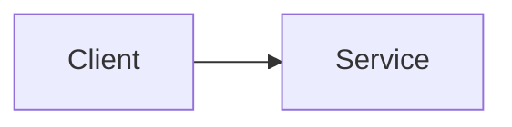

import GithubLinkAdmonition from '@site/src/components/GithubLinkAdmonition';

# Project Title

<GithubLinkAdmonition 
    link="https://github.com/<your-user>/<your-repository>"
    title="Github Tip" 
    type="tip"
>
Checkout this repository to see the code/implementation
</GithubLinkAdmonition>

A simple and brief description and intro to the project.

## TOC

- [Description](#description)
- [Tech Stack](#tech-stack)
- [Quickstart](#quickstart)
- [Usage](#usage)
- [Security Notes](#security-notes)
- [Known Limitations](#known-limitations)
- [Further References](#further-references)

## Description

What does the project do, and why did you build it? Add a screenshot or a diagram:

## Tech Stack

- Technology 1
- Technology 2

## Quickstart

1. do X
2. do Y

## Usage

## Security Notes

## Known Limitations

## Further References
