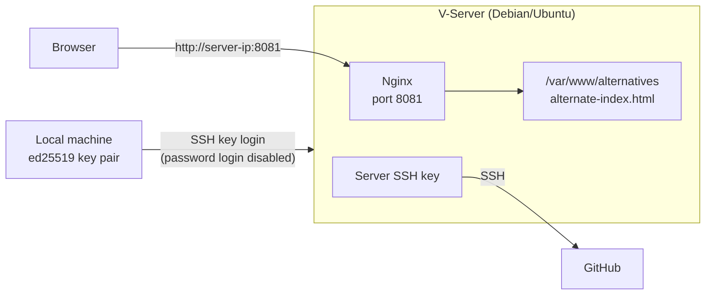

import GithubLinkAdmonition from '@site/src/components/GithubLinkAdmonition';

# V-Server Setup

<GithubLinkAdmonition 
    link="https://github.com/hpetersen2/V-Server-Setup"
    title="Github Tip" 
    type="tip"
>
Checkout this repository to see the code/implementation
</GithubLinkAdmonition>

This page documents how I configured my very first cloud server instance in the Developer Akademie DevSecOps Course.

## TOC

- [Description](#description)
- [Tech Stack](#tech-stack)
- [1. Generate an SSH Key on Your Local Machine](#1-generate-an-ssh-key-on-your-local-machine)
- [2. Connect to the V-Server](#2-connect-to-the-v-server)
- [3. Copy the SSH Key to the V-Server](#3-copy-the-ssh-key-to-the-v-server)
- [4. Disable Password Authentication](#4-disable-password-authentication)
- [5. Test Password Login (Should Fail)](#5-test-password-login-should-fail)
- [6. Reconnect Using SSH Key Authentication](#6-reconnect-using-ssh-key-authentication)
- [7. Install Nginx](#7-install-nginx)
- [8. Configure Nginx to Forward Requests to Port 8081](#8-configure-nginx-to-forward-requests-to-port-8081)
- [9. Add an Alternate HTML Page](#9-add-an-alternate-html-page)
- [10. Set Up Git on the Server](#10-set-up-git-on-the-server)
- [Security Notes](#security-notes)
- [Troubleshooting](#troubleshooting)

## Description

In this project I set up my first V-Server from scratch as part of the Developer Akademie DevSecOps course. The goal was to get a small but properly secured server that can serve web content and pull code from GitHub.

The setup covers three areas:

- **Secure access:** Logging in with an SSH key pair (ed25519) and disabling password authentication, so brute-force attacks on the login no longer work.
- **Web server:** Installing Nginx and serving a custom HTML page on port 8081 through a separate server block.
- **Git integration:** Creating an SSH key on the server and registering it with GitHub, so the server can access repositories without a password.

The steps below are written so you can follow them in order on a fresh Linux server (Debian/Ubuntu).



## Tech Stack

- **Linux** (Debian/Ubuntu) on a V-Server
- **OpenSSH** with ed25519 keys
- **Nginx** as web server
- **Git/GitHub** over SSH

## 1. Generate an SSH Key on Your Local Machine

```bash
ssh-keygen -t ed25519
```

- Specify the desired file path for the key pair.
- Optionally, protect your key with a passphrase.

---

## 2. Connect to the V-Server

```bash
ssh your-user@server-ip
```

Replace `your-user` and `server-ip` with your actual username and server IP address.

---

## 3. Copy the SSH Key to the V-Server

```bash
ssh-copy-id -i ~/.ssh/id_ed25519.pub your-user@server-ip
```

:::note
The command `ssh-copy-id` must be installed on your system.
:::

---

## 4. Disable Password Authentication

:::warning Keep a second session open
Do not close your current SSH session until you have verified that the key login works in a **second** terminal (see [step 6](#6-reconnect-using-ssh-key-authentication)). If you lock yourself out, you can only get back in through the console of your hosting provider.
:::

1. Navigate to the SSH configuration directory:

   ```bash
   cd /etc/ssh/
   ```

2. Open the SSH configuration file:

   ```bash
   sudo nano sshd_config
   ```

3. Find the line containing `PasswordAuthentication`, uncomment it, and set the value to `no`:

   ```text
   PasswordAuthentication no
   ```

   On newer Ubuntu releases, files in `/etc/ssh/sshd_config.d/` can override this setting. Check them as well:

   ```bash
   sudo grep -r PasswordAuthentication /etc/ssh/sshd_config /etc/ssh/sshd_config.d/
   ```

4. Check the configuration for syntax errors:

   ```bash
   sudo sshd -t
   ```

   No output means the file is valid.

5. Restart the SSH service:

   ```bash
   sudo systemctl restart ssh.service
   ```

6. Exit the server:

   ```bash
   exit
   ```

---

## 5. Test Password Login (Should Fail)

Verify that password-based authentication is disabled:

```bash
ssh -o PubkeyAuthentication=no your-user@server-ip
```

You should **not** be able to log in. The server answers with `Permission denied (publickey)`.

---

## 6. Reconnect Using SSH Key Authentication

```bash
ssh -i ~/.ssh/id_ed25519 your-user@server-ip
```

---

## 7. Install Nginx

Update the package list and install Nginx:

```bash
sudo apt update
sudo apt install nginx -y
```

:::note
The `-y` flag automatically confirms the installation.
:::

---

## 8. Configure Nginx to Forward Requests to Port 8081

Create a new Nginx configuration file in `sites-available`:

```bash
sudo nano /etc/nginx/sites-available/alternatives
```

Insert the following configuration:

```nginx
server {
    listen 8081;
    listen [::]:8081;

    root /var/www/alternatives;
    index alternate-index.html;

    location / {
        try_files $uri $uri/ =404;
    }
}
```

Save and close the file. Enable the site with a symbolic link, check the configuration and reload Nginx:

```bash
sudo ln -s /etc/nginx/sites-available/alternatives /etc/nginx/sites-enabled/alternatives
sudo nginx -t
sudo systemctl reload nginx
```

If a firewall such as `ufw` is active, open the port as well:

```bash
sudo ufw allow 8081/tcp
```

---

## 9. Add an Alternate HTML Page

The `root` directive from step 8 points to `/var/www/alternatives` and `index` to `alternate-index.html`. Create the directory and the file at exactly that location:

```bash
sudo mkdir -p /var/www/alternatives
sudo nano /var/www/alternatives/alternate-index.html
```

Put any HTML into the file, for example:

```html
<!DOCTYPE html>
<html lang="en">
  <head>
    <meta charset="utf-8" />
    <title>Alternate page</title>
  </head>
  <body>
    <h1>Hello from port 8081</h1>
  </body>
</html>
```

You can now access your page via port **8081** (e.g., `http://your-server-ip:8081`).

---

## 10. Set Up Git on the Server

### 1. Generate an SSH Key on the Server

```bash
ssh-keygen -t ed25519
```

Specify the file path for the key pair.

---

### 2. Display and Copy the SSH Public Key

```bash
cat ~/.ssh/id_ed25519.pub
```

Copy the displayed SSH key. If you saved the key under a different path, use that path instead.

---

### 3. Add the SSH Key to GitHub

1. Log in to your **GitHub** account.
2. Go to **Settings → SSH and GPG keys**.
3. Click **New SSH key**.
4. Enter a **Title** (e.g., "V-Server Access").
5. Paste the copied SSH key into the **Key** field.
6. Save the new SSH key.

---

### 4. Test the Connection

On the server, run:

```bash
ssh -T git@github.com
```

On the first connection, confirm the GitHub host fingerprint with `yes`. The expected answer is:

```text
Hi <your-github-username>! You've successfully authenticated, but GitHub does not provide shell access.
```

---

### Setup Complete

Your V-Server is now:

- Secured with SSH key authentication
- Configured with Nginx running on port **8081**
- Ready to connect to GitHub via SSH

## Security Notes

- Never share or commit your **private** key (`id_ed25519`). Only the `.pub` file is meant to be copied.
- Protect the key on your local machine with a passphrase.
- Only open the ports you actually need (SSH and the Nginx port). Everything else should stay closed.
- Keep the server up to date with `sudo apt update && sudo apt upgrade`.
- The Nginx page on port 8081 uses plain HTTP. Use HTTPS (for example with Let's Encrypt) for anything beyond a test page.

## Troubleshooting

| Problem | Possible cause and fix |
|---------|------------------------|
| `Permission denied (publickey)` although the key is correct | The key was not copied (step 3), or the wrong key file is used. Pass the key explicitly with `-i`. |
| Password login still works after step 4 | A file in `/etc/ssh/sshd_config.d/` overrides the setting, or SSH was not restarted. |
| Browser shows `404 Not Found` on port 8081 | The file is not at `/var/www/alternatives/alternate-index.html` (see step 9). |
| Browser cannot connect to port 8081 | The firewall blocks the port, or Nginx is not running. Check with `sudo ufw status` and `sudo systemctl status nginx`. |
| `nginx -t` reports an error | Fix the file shown in the message, then run `sudo nginx -t` again before reloading. |
